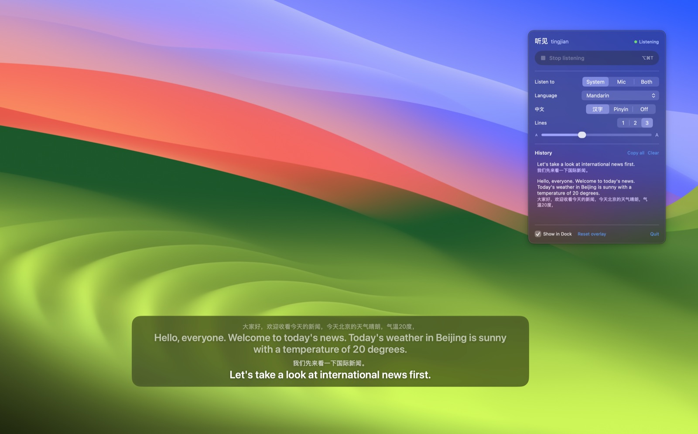
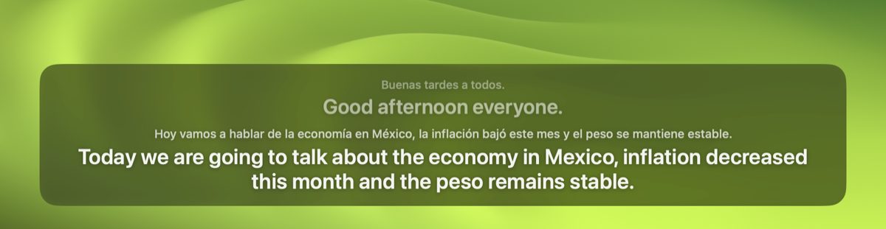

<p align="center"></p>

# tingjian 听见

A personal macOS menu bar app that listens to everything (system audio, plus the mic if enabled) and shows live translation into English from **Mandarin**, **Spanish (Latin America)** or **French** (picked in the menu) in a sleek floating overlay. Everything runs **locally**.



## What it looks like

The subtitles sit at the bottom of the screen above everything, full-screen video included. The newest line is at the bottom, and older lines fade out. A line stays dim while the speaker is mid-sentence and turns solid once it's final.

**Mandarin**, with the characters above the English:


**Mandarin with pinyin** instead of characters:


**Spanish (Latin America):**



**French:**


## Examples

Real output from `tingjian-cli file`, using clips spoken by the macOS voices:

| Language | Heard | Shown |
|---|---|---|
| Mandarin | 大家好，欢迎收看今天的新闻，今天北京的天气晴朗，气温20度， | Hello, everyone. Welcome to today's news. Today's weather in Beijing is sunny with a temperature of 20 degrees. |
| Mandarin | 我们先来看一下国际新闻。 | Let's take a look at international news first. |
| Mandarin | 昨天联合国召开了一次关于气候变化的会议，很多国家的领导人都参加了 | Yesterday, the United Nations held a meeting on climate change, and leaders from many countries attended. |
| Spanish | Hoy vamos a hablar de la economía en México. | Today we are going to talk about the economy in Mexico. |
| Spanish | La inflación bajó a 3.5% este mes y el peso se mantiene estable frente al dólar. | Inflation fell to 3.5% this month and the peso remains stable against the dollar. |
| French | Bonsoir et bienvenue, les températures à Paris ont atteint un record cette semaine. | Good evening and welcome, temperatures in Paris have reached a record this week. |

Mandarin and Spanish recognition was accurate in testing. French recognition is the weakest: with the macOS voices it misheard some words (*climat* → *cinéma*, *35* → *25*). Real speech may do better.

As the speaker talks, the live line and its translation keep updating (`tingjian-cli` output):

```
[  2.44s] live  大家好  →  hello, everyone
[  3.72s] live  大家好，欢迎收  →  Hello, everyone. Welcome to receive.
[  4.70s] live  大家好，欢迎收看今天的  →  Hello, everyone. Welcome to watch today's
[  5.75s] live  大家好，欢迎收看今天的新闻，今天  →  Hello, everyone. Welcome to watch today's news. Today
[  7.80s] live  大家好，欢迎收看今天的新闻，今天北京的天气晴朗  →  Hello, everyone. Welcome to today's news. The weather in Beijing is sunny today.
```

## Using it

- **Start / stop:** menu bar icon › *Start listening*, or **⌥⌘T** anywhere.
- **Hotkey:** click the shortcut next to *Hotkey* in the menu and press a new one. It needs ⌘, ⌥ or ⌃, unless it's a function key. While recording, ⌫ sets no hotkey and Esc cancels; ✕ clears it and ↺ restores ⌥⌘T. macOS doesn't flag a clash with another app's shortcut, so pick one nothing else uses.
- **Language:** the *Language* dropdown in the menu. The row below it shows or hides the original text; for Mandarin it can also show pinyin.
- **Source:** *System* (everything playing on the Mac), *Mic*, or *Both*.
- **Move the overlay:** hold **⌘** over the subtitles and drag. A dashed outline shows it's draggable. *Reset overlay* puts it back.
- **History:** the menu lists this session's lines. Click one to copy it, or use *Copy all*.
- **Dock:** tick *Show in Dock* for a Dock icon. Clicking it opens the controls in a window, and right-clicking it gives Start/Stop.
- **Scripting:** `open build/tingjian.app --args --start` starts listening on launch. Posting the distributed notification `com.pedroslopez.tingjian.toggle` toggles it.
- **Logs:** `log stream --predicate 'subsystem == "com.pedroslopez.tingjian"' --info`

## Build & run

Only Command Line Tools are needed (no Xcode). Target: macOS 26.4+, Apple silicon.

```sh
scripts/make-signing-identity.sh   # once: self-signed identity in its own keychain
scripts/bundle.sh --run            # build/tingjian.app, (re)launch it
```

`bundle.sh` signs with the local identity, so the designated requirement
(`identifier "com.pedroslopez.tingjian" and certificate leaf = …`) is stable and
privacy grants survive rebuilds. Without the identity it falls back to ad hoc
signing, which resets grants on every build. Regenerate the app icon with
`swift scripts/make-icon.swift`.

### Releases

`.github/workflows/release.yml` builds the app on a macOS runner and attaches
`tingjian-<version>-macos-arm64.zip` (plus its SHA-256) to a GitHub release:

```sh
scripts/release.sh patch      # or minor / major / an explicit 0.4.0-beta; -n shows what it would do
```

It checks that `main` is clean and pushed, works out the next version from the latest `v*` tag,
and then tags and pushes it, which triggers the workflow. Alternatively, use *Actions › Release ›
Run workflow* with a version.

The version is only the tag: `bundle.sh` writes it to `CFBundleShortVersionString`, and the
commit count becomes `CFBundleVersion`. The menu shows the version next to the name; hover it
to see the build number. Tick *dry run* there to only build
and upload the zip as a workflow artifact.

CI signs with the same self-signed identity as local builds, so permission grants carry over
between releases. It reads the identity from the `SIGNING_P12_BASE64` secret. To replace the
identity, run `scripts/make-signing-identity.sh --force`, which saves a new `.p12` under
`~/Library/Application Support/tingjian/`, then update the secret:

```sh
base64 -i ~/Library/Application\ Support/tingjian/signing-identity.p12 | gh secret set SIGNING_P12_BASE64
```

Downloaded builds aren't notarized. On first launch, allow the app under Privacy & Security ›
*Open Anyway*, or run `xattr -dr com.apple.quarantine /Applications/tingjian.app`.

### Permissions

| What | When | Where |
|---|---|---|
| System Audio Recording | first start with source *System* / *Both* | System Settings › Privacy & Security › Screen & System Audio Recording (*System Audio Recording Only*) |
| Microphone | first start with source *Mic* / *Both* | Privacy & Security › Microphone |

No Accessibility or Screen Recording permission is needed; the hotkey (default ⌥⌘T) uses
Carbon `RegisterEventHotKey`. If the overlay only says "Only silence so far" while audio is
playing, the System Audio Recording grant is missing.

Models (on-device, one-time): the speech model for the selected language (zh-CN, es-MX, fr-FR)
downloads automatically on first start. The translation model (zh-Hans, es, fr → en) must be
installed under System Settings › General › Language & Region › Translation Languages.

### CLI

`swift run tingjian-cli [--lang zh|es|fr] <command>` runs the same pipeline headless:

- `check`: whether the language's transcriber and its → en translation are installed.
- `install`: downloads the language's speech model.
- `file <audio>`: plays a file through ASR and translation in real time.
- `tap [s]` / `mic [s]`: live capture.

Quick test: `say -v Tingting -o /tmp/zh.aiff "今天天气很好。" && swift run tingjian-cli file /tmp/zh.aiff`

## Stack

| Layer | Choice |
|---|---|
| App shell | Swift + SwiftUI `MenuBarExtra`, `LSUIElement` (optional Dock icon) |
| Audio capture | Core Audio process taps (`CATapDescription` / aggregate device) for system audio + optional `AVAudioEngine` mic |
| ASR | Apple `SpeechAnalyzer` + `SpeechTranscriber` (zh-CN, es-MX, fr-FR), volatile results for live partials |
| Translation | Apple `Translation` framework, `TranslationSession(installedSource:target:)` → en, high-fidelity strategy |
| Overlay | Non-activating floating `NSPanel`, all Spaces, click-through, glass background |
| Trigger | Menu bar, Dock, or a configurable global hotkey (default ⌥⌘T) |

Recognizer text is split into subtitle-sized sentences. Partial lines are translated on a
throttle, and final lines are translated once more definitively. Settled sentences are cached,
so they aren't re-translated on every update.

### Fallbacks (behind protocols)

- **ASR:** sherpa-onnx streaming Paraformer zh-en, or WhisperKit large-v3-turbo.
- **Translation:** local LLM via MLX (e.g. Qwen3 ~8B) with rolling context.

## Layout

- `Sources/TingjianCore`: audio sources (process tap, mic, file), `SpeechRecognizer` / `Translator`
  protocols plus the Apple implementations, languages, sentence segmentation, `Transcript`, and `ListeningSession`.
- `Sources/Tingjian`: the menu bar app (model, overlay panel, menu, hotkey).
- `Sources/tingjian-cli`: the feasibility check and headless runs.
- `scripts/`: bundling, signing identity, icon.
- `docs/`: README images.
